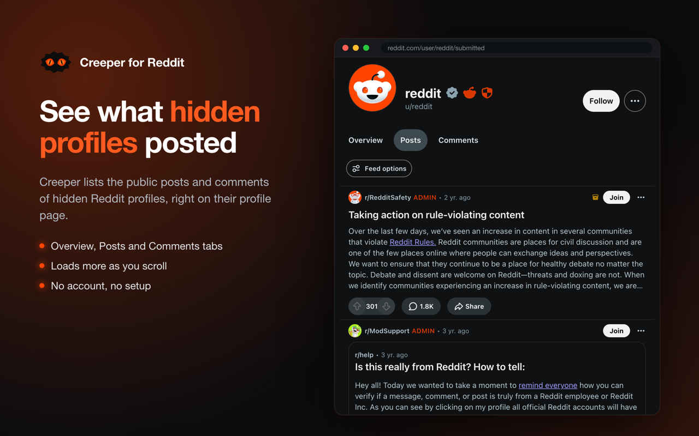
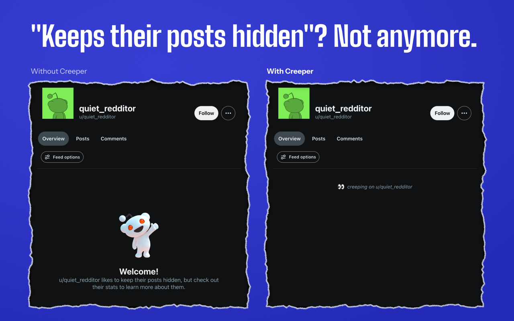
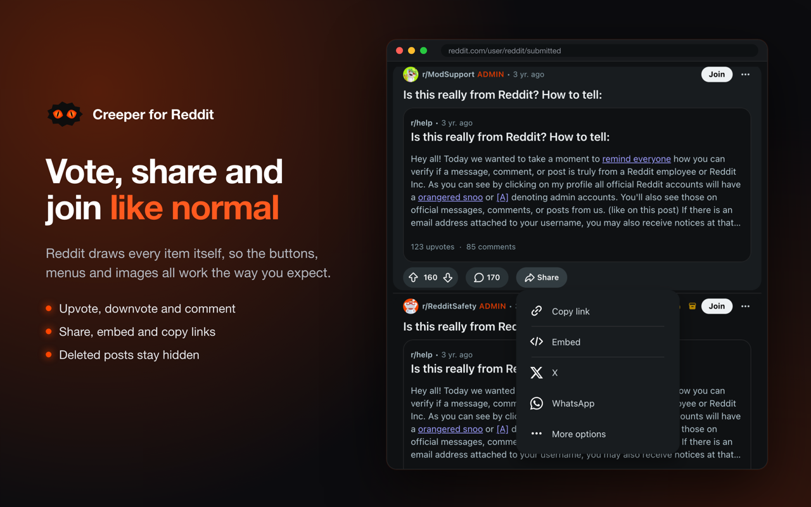

<p align="center">
  
</p>

# Creeper for Reddit

A Chrome extension that shows the posts and comments of Reddit profiles that hide their history. They appear on the profile page the same way they would on a public profile, and you can vote, share, repost and open menus as usual.



## How it works

Reddit lets users hide their history from their profile, but the posts and comments stay public in the communities where they were made. The extension finds them again in two steps:

1. It asks the public [Arctic Shift](https://arctic-shift.photon-reddit.com) archive for the IDs of the user's posts and comments, newest first.
2. It asks Reddit to draw each item with its own components. Reddit draws them exactly as they look on a public profile, with the current score.



Items load in order as you scroll. Posts and comments the author deleted stay hidden. Because Reddit draws each item, its buttons and menus work as usual:



The extension runs only on `www.reddit.com`, on the Overview, Posts and Comments tabs of a profile that shows Reddit's "hidden" message. Public profiles are left alone.

## Install

From the Chrome Web Store: coming soon.

From source:

1. Download or clone this repo.
2. Open `chrome://extensions` and turn on **Developer mode**.
3. Click **Load unpacked** and choose the repo folder.
4. Open a Reddit profile that hides its history.

## Files

| File | What it does |
|---|---|
| `manifest.json` | Extension settings. The content script runs on `https://www.reddit.com/*` at page start. |
| `content.js` | Detects a hidden profile, fetches IDs from Arctic Shift, gets each item from Reddit and adds it to the feed. |
| `content.css` | Hides Reddit's "hidden profile" message before it paints, and styles the loader and Retry button. |
| `icons/` | Extension icons. `icon.svg` is the source drawing. |

## Testing on a public profile

Run this in the browser console on reddit.com, then open any profile:

```js
localStorage.setItem('creeper:force', '1')
```

The extension then replaces the profile feed with its own. Remove the key to turn this off.

## Limits

- It shows only what Arctic Shift has archived, so very new items may be missing.
- It depends on Reddit's page markup. When Reddit changes it, the extension needs an update.
- No sorting yet. Items are always newest first.

## Privacy

The extension sends the viewed profile's username to Arctic Shift and nothing else. It stores nothing. See [PRIVACY.md](PRIVACY.md).

Not affiliated with or endorsed by Reddit, Inc.
